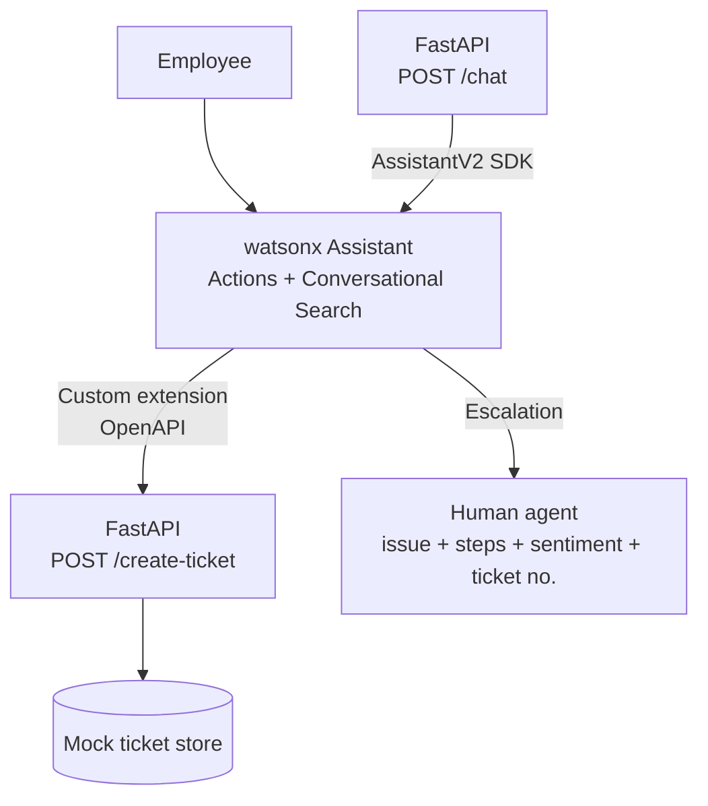

# 🤖 Cognitive Process Automation Assistant

**IT support automation built on IBM watsonx Assistant, Watson APIs, and FastAPI.**

    

A hands-on cognitive process automation prototype for a fictional enterprise client. Employees talk to a watsonx Assistant that **collects and validates information (User Assist)**, **creates tickets through an OpenAPI-specified FastAPI service**, **answers policy questions from source documents**, and **escalates to a human agent (Agent Assist)** with full context when the conversation isn't going well.

---

## ✨ Highlights

- 🎫 **3 automated ticket workflows:** password reset, laptop request, and system access request
- ✅ **User Assist:** guided field collection, validation, and confirmation before any ticket is created
- 📚 **Grounded policy Q&A:** conversational search over VPN, IT equipment leave, and security policies
- 🙋 **Agent Assist handoff:** escalates on repeated failures or user frustration, passing the issue, collected fields, and sentiment to a human agent
- 🔌 **OpenAPI-specified service:** the assistant calls the FastAPI ticket service through a custom extension built from `openapi.json`
- 🧪 **Tested:** 10 scripted conversations scored on a Pass / Partial / Fail rubric (see [`docs/test-conversations.md`](docs/test-conversations.md))

---

## 🎯 Business Problem

| Process | Assistant behaviour | Integration | Benefit |
|---|---|---|---|
| Password reset | Collects employee ID and security answer, then confirms | `POST /create-ticket` (`password_reset`) | Fewer repetitive service-desk contacts, with identity checks kept |
| Laptop request | Collects employee ID, department, laptop type, justification, then confirms | `POST /create-ticket` (`laptop_request`) | Standardized intake and approval routing |
| Access request | Collects system and manager, then confirms | `POST /create-ticket` (`access_request`) | Complete, traceable access requests |
| Policy questions | Conversational search over policy documents | watsonx Assistant search / knowledge source | Consistent, source-grounded answers |
| Escalation | Detects frustration or two failed attempts, summarizes, hands off | Human-agent handoff; local summary model in `app/main.py` | Context preserved, less discovery time for the agent |

---

## 🏗 Architecture



**Design decisions**

- **Contract first:** the ticket service is described in `openapi.json`, so the assistant's extension and the backend share one source of truth.
- **Validated inputs:** Pydantic models enforce request and response schemas in the FastAPI service.
- **Secrets stay out of Git:** API keys, service URL, assistant ID, and environment ID live only in `.env`; `.env.example` shows the expected variables.
- **Escalation keeps context:** the handoff summary includes the issue, completed steps, sentiment, and ticket number, so the human agent doesn't restart the conversation.

---

## 🧰 Tech Stack

| Layer | Technology |
|---|---|
| Conversational AI | IBM watsonx Assistant (Actions, conversational search, custom extension) |
| Backend | Python 3.10+, FastAPI, Uvicorn |
| SDK / Client | IBM Watson Python SDK (`ibm-watson`, AssistantV2) |
| Validation | Pydantic |
| API spec | OpenAPI (`openapi.json`) |
| Config | python-dotenv |

---

## 📁 Project Structure

```text
.
├── app/
│   ├── __init__.py
│   ├── main.py             # FastAPI app: /create-ticket, /chat, escalation summary
│   └── watson_client.py    # watsonx Assistant v2 SDK client
├── docs/
│   └── test-conversations.md   # 10 scripted test conversations + Pass/Partial/Fail scoring
├── policies/
│   ├── it-equipment-leave-policy.md
│   ├── security-policy.md
│   └── vpn-policy.md       # source documents for grounded policy Q&A
├── .env.example
├── openapi.json            # API contract used by the assistant extension
├── requirements.txt
└── README.md
```

---

## 🚀 Quick Start

**Prerequisites:** Python 3.10+ and an IBM Cloud account with a watsonx Assistant instance.

**1. Clone and install**

```bash
git clone https://github.com/adityamohancse/cognitive-process-automation-assistant.git
cd cognitive-process-automation-assistant
```

Windows (PowerShell):

```powershell
py -m venv .venv
.\.venv\Scripts\Activate.ps1
pip install -r requirements.txt
Copy-Item .env.example .env
```

macOS / Linux:

```bash
python3 -m venv .venv
source .venv/bin/activate
pip install -r requirements.txt
cp .env.example .env
```

**2. Configure `.env`** with your watsonx Assistant API key, service URL, assistant ID, and environment ID (see `.env.example`). Never commit this file.

**3. Run the service**

```bash
uvicorn app.main:app --reload
```

Open **http://127.0.0.1:8000/docs** for the interactive API docs.

> **Note on plans:** IBM documentation says the Assistant v2 runtime API (used by `/chat`) requires a Plus plan or higher, and entitlements vary by account. Check your plan's limits before relying on `/chat`. The Assistant action build and the `/create-ticket` integration can be demonstrated independently.

---

## 🔌 API Endpoints

| Method | Endpoint | Purpose |
|---|---|---|
| `POST` | `/create-ticket` | Creates a ticket (`password_reset`, `laptop_request`, or `access_request`) in the mock store |
| `POST` | `/chat` | Sends a message to watsonx Assistant through the v2 SDK |

---

## 🛠 Building the Assistant

### Day 1: Process design and Assistant UI

1. **Define the process.** Actors are employees, service desk agents, and approvers. Systems are watsonx Assistant and the ticket API. Controls are identity validation, confirmation, auditability, and escalation.
2. **Create the four actions** (password reset, laptop request, access request, policy Q&A) in the Assistant editor. Menu labels can differ by tenant, so look for the current equivalents of Actions, Extensions, Search, and Preview.
3. **Order the steps in each action:** collect, validate, confirm, call the extension (added on Day 2), then report the result. Use variables such as `employee_id`, `department`, `laptop_type`, `justification`, `system_name`, and `manager_name`.
4. **Add a fallback.** On the first failure, ask the user to rephrase or pick a supported value. On the second failure, offer human help and keep the summary.

<!-- Paste Day 2 and Day 3 from your original README here -->

---

## 🔭 Limitations and Future Work

- Tickets are stored in a **mock in-memory store**; production use would connect to a real ITSM tool such as ServiceNow or Jira Service Management.
- Identity validation uses a demo security-answer check; a real deployment would integrate with SSO or MFA.
- Add automated tests (pytest) for the API alongside the scripted conversation tests.
- Add Docker packaging and CI for repeatable deployment.

---

## 👤 Author

**Aditya Mohan Jha**: Software Engineer, Bengaluru, India

[](https://linkedin.com/in/adityamohancse) [](mailto:mohanjhaaditya74@gmail.com) [](https://github.com/adityamohancse)
